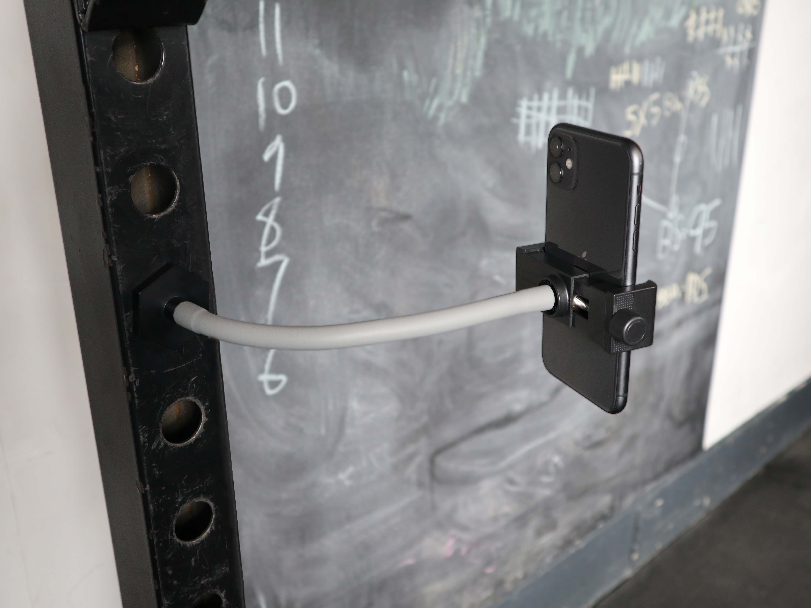
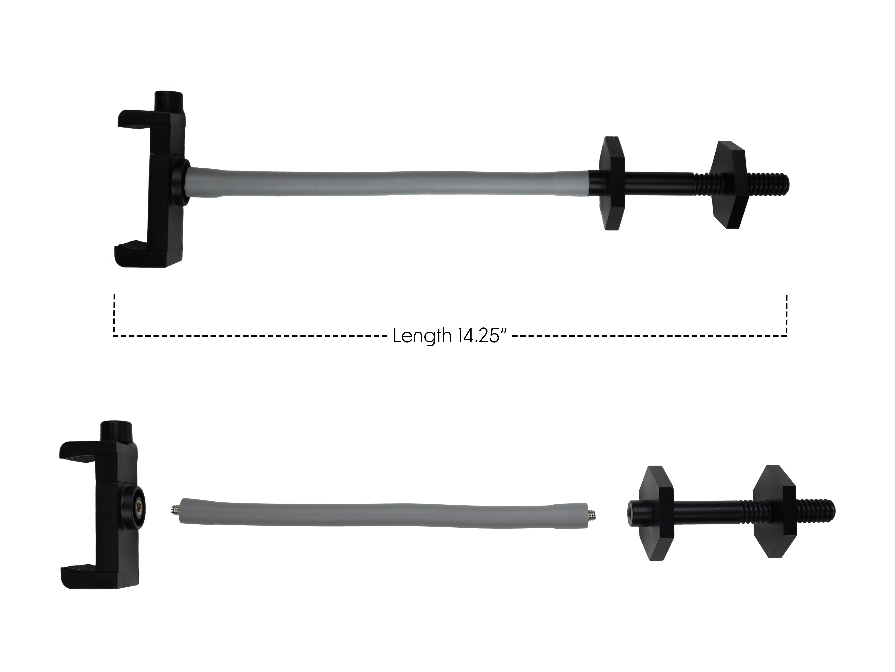
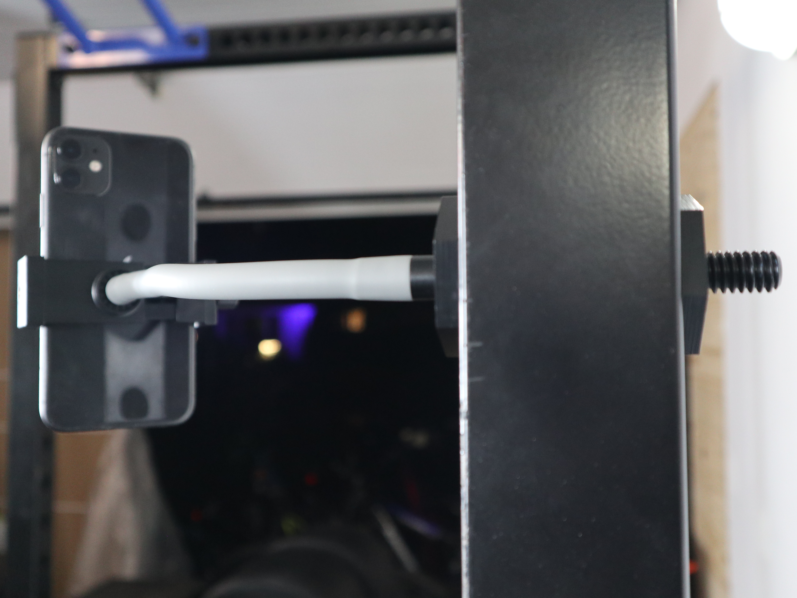
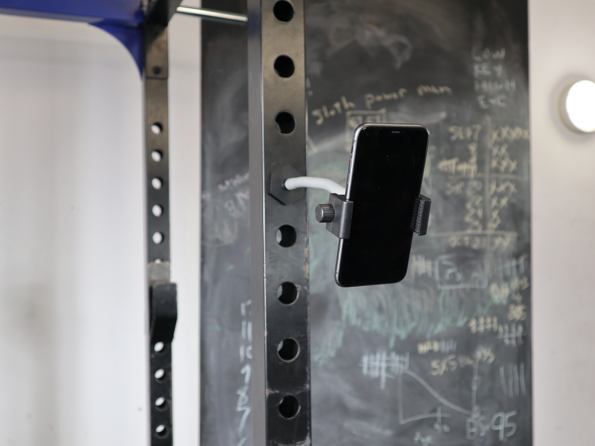
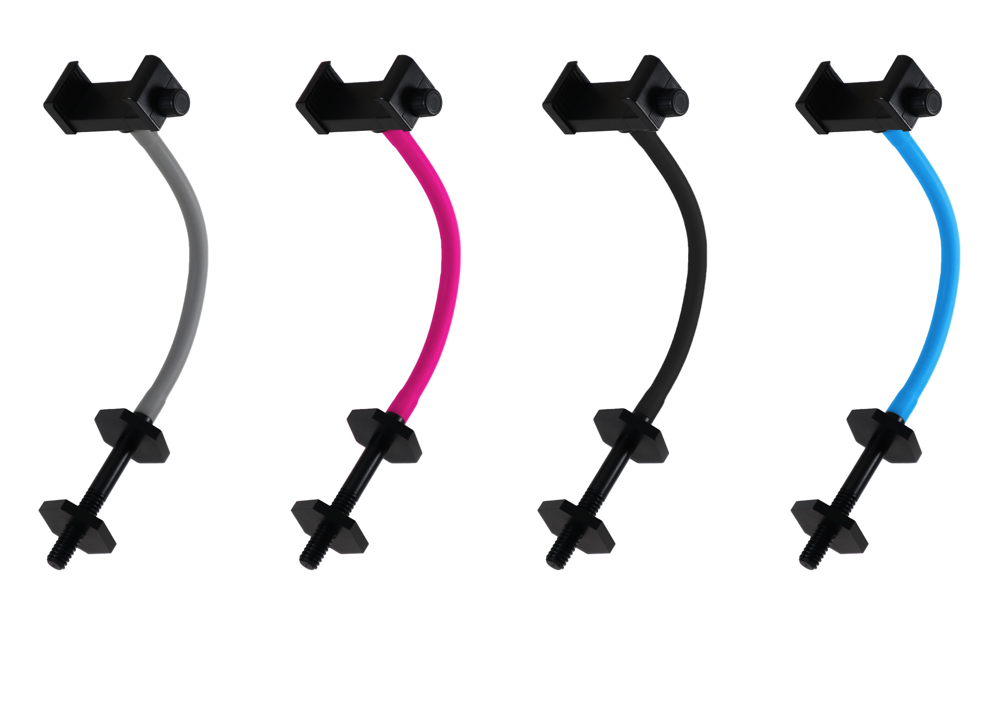
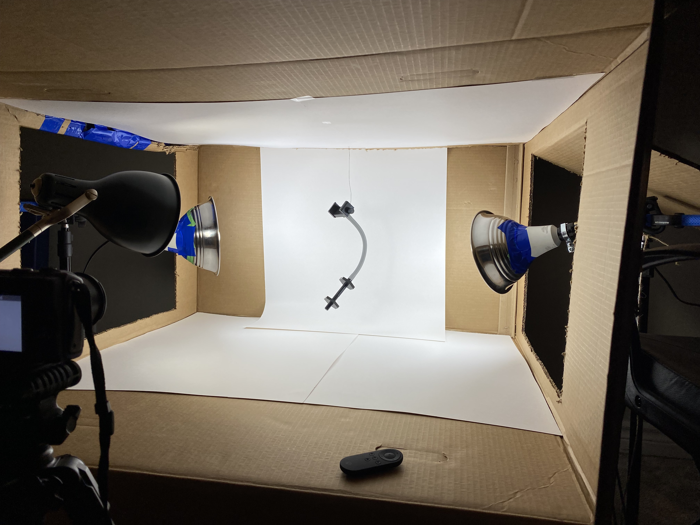
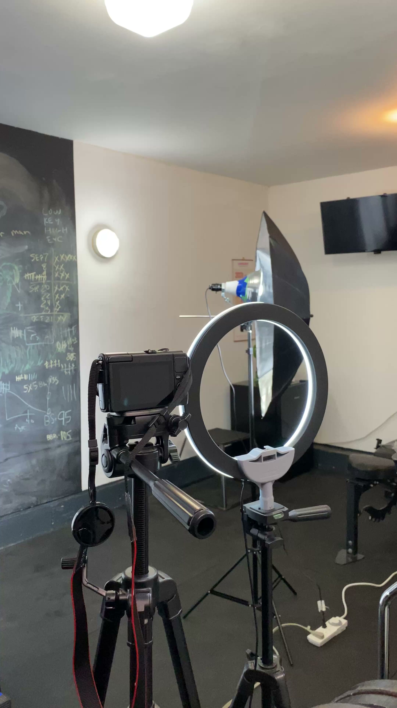

# RakFlex

I developed RakFlex, a gym phone mount, from an idea through 3D-printed prototypes, component sourcing, assembly, and a Kickstarter campaign.

[View the original campaign and watch the full ad](https://www.kickstarter.com/projects/rakflex/rakflex)

## What I built

RakFlex is an adjustable phone holder that attaches through a hole in a gym rack or cage. It lets someone position a phone to record an exercise, review their form, or capture their progress. The assembly combines a phone holder, a flexible gooseneck, and a threaded rack attachment.

## Why this is in my software portfolio

I included RakFlex because it shows how I work through a project beyond writing code. I had to turn a practical problem into requirements, experiment with a physical solution, source compatible parts, work through fit and material decisions, and communicate the result clearly enough to launch it publicly.

Those habits matter in software development too: breaking a problem into manageable parts, evaluating dependencies, working through integration problems, and following through on the details needed to deliver something people can understand and use. This repository presents the product-development work behind RakFlex alongside my software projects.

## How I approached the project

1. **Define the problem.** I wanted a way to position a phone on a gym rack for exercise photos and videos.
2. **Print the early prototypes.** I designed and 3D-printed a nut-and-screw rack attachment and a custom two-part phone holder. The [four prototype STEP files](cad/prototypes/README.md) show this stage.
3. **Source compatible components.** I talked with suppliers in China and obtained goosenecks in different colours with the correct mating male and female fittings.
4. **Revise the assembly.** I moved the black rack-mount component to CNC-machined aluminum and replaced my printed phone holder with a smaller, cheaper purchased holder.
5. **Present the product.** I created product photography, an advertisement, and a Kickstarter campaign with a production and fulfillment plan.

The included CAD files are early prototype designs. They do not contain the gooseneck or represent the final CNC mount or purchased phone holder. The [development overview](docs/development.md) explains those changes.

## The product in detail

The campaign graphic shows the three main components separately and an assembled length of 14.25 inches.

These are the colour options shown in the campaign artwork.

## Product photography

I built a simple photography setup from a cardboard box, white backing, and lamps to create the clean white background for the product shots. I suspended the assembled mount in front of the backdrop and photographed it for the campaign.

My white-background photography setup:

My camera and lighting setup for filming the campaign:

## Campaign and outcome

The campaign ran from April 17 to May 17, 2022. You can watch the full advertisement on the [original Kickstarter page](https://www.kickstarter.com/projects/rakflex/rakflex).

Ultimately, the campaign failed to reach its funding goal, raising **CA$518 from 11 backers** against a **CA$5,200 target**. I had no marketing experience, and I see that as a major reason it fell short. The project taught me that developing a product and reaching the people who might buy it require different skills.

## Repository contents

- `cad/prototypes/`: four early prototype STEP files and their component roles.
- `assets/images/`: product images, campaign graphics, and my photography setup.
- `docs/development.md`: how I prototyped, sourced components, and revised the design.
