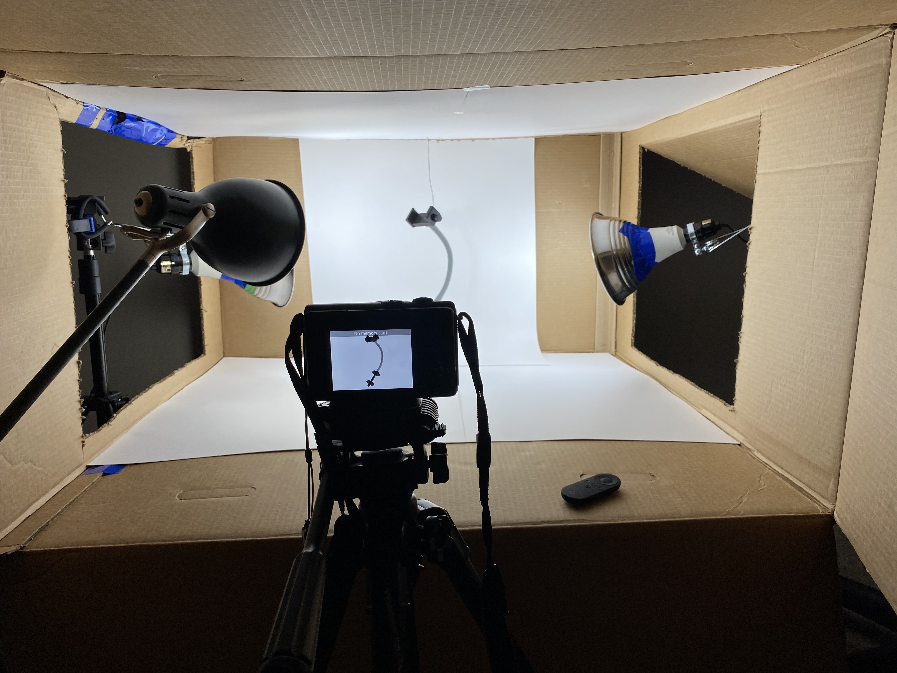

# Developing RakFlex

I developed RakFlex around three components: a rack attachment, a flexible gooseneck, and a phone holder. I started with printed prototypes, then combined custom and purchased parts for the final assembly.

## Printed prototypes

I designed and 3D-printed parts for both ends of the gooseneck. At the rack end, a nut and screw secured the mount to the cage. At the phone end, two mating parts formed a custom holder.

The [prototype CAD folder](../cad/prototypes/README.md) contains the four STEP files for those early parts. It does not include the gooseneck or the final product's manufacturing drawings.

## Sourcing and fit

I talked with suppliers in China and obtained goosenecks in different colours with the correct mating male and female fittings. The neck had to connect to the rack attachment at one end and the phone holder at the other, so finding compatible fittings was essential to making the assembly work.

## Revising the design

I moved the black component that fits into the rack or cage to CNC-machined aluminum.

I also realized that buying an existing phone holder from China could make the phone end much smaller and cheaper than my custom printed design. That purchased holder became part of the final product. Developing the prototype helped me decide which parts to make myself and which to buy.

| Component | Early prototype | Later product |
| --- | --- | --- |
| Rack attachment | Custom printed nut and screw | Black rack-mount component CNC-machined from aluminum |
| Gooseneck | Separately sourced component | Coloured goosenecks with compatible male and female fittings |
| Phone holder | Custom printed male and female halves | Purchased holder chosen to reduce size and cost |

This image shows the later assembly, including the purchased phone holder.

## Advertisement and campaign

Once I had the physical assembly, I created product photography and an advertisement to explain how it worked. The [Kickstarter campaign](https://www.kickstarter.com/projects/rakflex/rakflex) includes the full ad.

For the white-background product photos, I made a setup using a cardboard box, white backing, and lamps. Suspending the product let me photograph the full assembly against the backdrop, with the camera positioned on a tripod.

My campaign plan allowed 20 days for production and quality control, followed by 7–14 days for inbound shipping, another inspection, packaging, and dispatch to backers. The campaign did not reach its funding goal, so that proposed schedule did not become a funded production run.

## Connection to software development

This project required me to break a problem into components, work through their interfaces, evaluate suppliers, and revise my design when an existing component offered a better fit. I included it alongside my software projects because it shows how I plan, solve integration problems, and follow a project through to a working demonstration and public launch.
